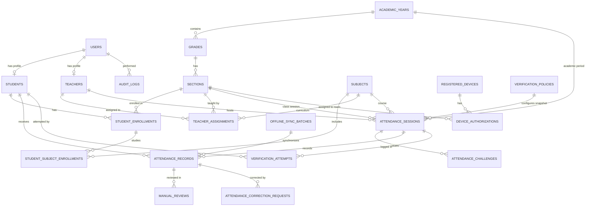

# Entity Relationship Model

---

## Entity Definitions & Indexes

### 1. `users`
- `id` UUID PRIMARY KEY
- `username` VARCHAR(64) UNIQUE NOT NULL
- `password_hash` VARCHAR(255) NOT NULL
- `role` VARCHAR(32) NOT NULL (`ADMIN`, `TEACHER`, `STUDENT`)
- `account_status` VARCHAR(32) NOT NULL (`ACTIVE`, `SUSPENDED`, `ARCHIVED`)
- `created_at` TIMESTAMPTZ DEFAULT NOW()
- `updated_at` TIMESTAMPTZ DEFAULT NOW()
- `last_login_at` TIMESTAMPTZ

### 2. `academic_years`, `grades`, `sections`, `subjects`
- Normalized academic hierarchy.
- Foreign keys with `ON DELETE RESTRICT` to preserve historical integrity.
- Unique constraints on `(grade_id, name)` and `(academic_year_id, code)`.

### 3. `attendance_sessions`
- `id` UUID PRIMARY KEY
- `academic_year_id` UUID NOT NULL REFERENCES academic_years(id)
- `section_id` UUID NOT NULL REFERENCES sections(id)
- `subject_id` UUID NOT NULL REFERENCES subjects(id)
- `teacher_id` UUID NOT NULL REFERENCES teachers(id)
- `scheduled_start_at` TIMESTAMPTZ NOT NULL
- `scheduled_end_at` TIMESTAMPTZ NOT NULL
- `opened_at` TIMESTAMPTZ
- `closed_at` TIMESTAMPTZ
- `status` VARCHAR(32) NOT NULL (`SCHEDULED`, `OPEN`, `CLOSING`, `CLOSED`, `CANCELLED`)
- `policy_snapshot` JSONB NOT NULL
- `created_at` TIMESTAMPTZ DEFAULT NOW()

### 4. `attendance_records`
- `id` UUID PRIMARY KEY
- `attendance_session_id` UUID NOT NULL REFERENCES attendance_sessions(id)
- `student_id` UUID NOT NULL REFERENCES students(id)
- `status` VARCHAR(32) NOT NULL (`PRESENT`, `LATE`, `ABSENT`, `EXCUSED`, `PENDING_CONFIRMATION`, `REJECTED`)
- `verification_status` VARCHAR(32) NOT NULL (`SERVER_VERIFIED`, `OFFLINE_RECORDED`, `PENDING_MANUAL`, `MANUALLY_CONFIRMED`, `FLAGGED`)
- `recorded_at` TIMESTAMPTZ NOT NULL
- `server_received_at` TIMESTAMPTZ DEFAULT NOW()
- `idempotency_key` VARCHAR(64) UNIQUE NOT NULL
- `confirmed_by` UUID REFERENCES users(id)
- `confirmed_at` TIMESTAMPTZ
- `correction_reason` TEXT
- UNIQUE (`attendance_session_id`, `student_id`)

### 5. `attendance_challenges`
- `id` UUID PRIMARY KEY
- `attendance_session_id` UUID NOT NULL REFERENCES attendance_sessions(id)
- `challenge_type` VARCHAR(32) NOT NULL (`QR_TOKEN`, `SIX_DIGIT_CODE`)
- `token_hash` VARCHAR(255) NOT NULL
- `issued_at` TIMESTAMPTZ NOT NULL
- `expires_at` TIMESTAMPTZ NOT NULL
- `status` VARCHAR(32) NOT NULL (`ACTIVE`, `EXPIRED`, `REVOKED`)
- Index on `(attendance_session_id, status, expires_at)`
