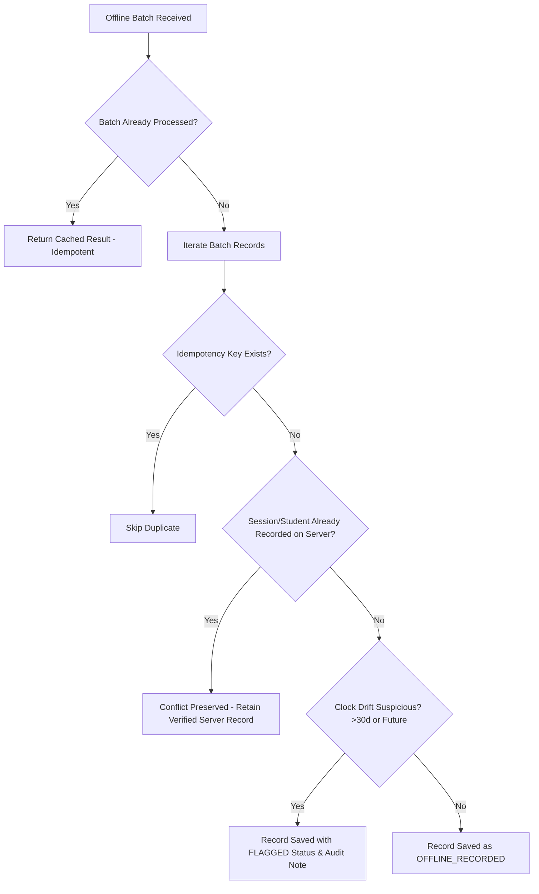

# Offline Attendance Synchronization Specification

## 1. Architectural Challenge

A disconnected client browser cannot reach the cloud server to validate rotating cryptographic tokens or submit real-time records. Pretending that real-time server verification can happen offline is insecure.

Therefore, our architecture provides a **Trusted Teacher Offline Protocol**:
1. When online, the teacher loads and caches the class roster into the browser's IndexedDB.
2. During an internet outage, the teacher conducts roll-call or offline student check-in via the PWA.
3. Every offline attendance event is sealed with:
   - Client-generated UUID `idempotency_key`
   - Exact client timestamp `device_recorded_at`
   - Explicit `sync_status = RECORDED_OFFLINE`
4. When connectivity returns, the PWA transmits the batch to `POST /api/v1/offline-sync/batches`.

---

## 2. Server-Side Conflict Resolution

### Trust Distinction:
- `SERVER_VERIFIED`: Real-time online check-in validated against active rotating challenges.
- `OFFLINE_RECORDED`: Authenticated teacher roll-call recorded during verified outage and synced cleanly.
- `FLAGGED`: Discrepant records or suspicious clock anomalies requiring administrator review.
